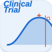

# Clinical Trial Sample Size (ct-samplesize)

- **English guide** → [README.md](https://github.com/medstatstar/ct-samplesize/blob/main/README.md) · **中文指南** → [README_zh-CN.md](https://github.com/medstatstar/ct-samplesize/blob/main/README_zh-CN.md)

  

> **Works without installation:** If you'd rather not install and just want to quickly use this skill's basic features, you can also visit the ct-series unified web portal **https://ct.medstatstar.com** directly.

> **Easy-to-use Clinical Sample Size & Power Calculator for Clinical Researchers**
>
> You don't need to code or memorize commands — just describe your trial design in **plain language inside a chat**, and the skill performs **65** professional sample-size & power calculations for you. The default authoritative engine is a **remote coze R compute service** (rpact, TrialSize, PowerTOST and 20+ other packages running server-side, so your machine needs **no local R**; the published skill has **no local compute fallback**). Results come in Chinese or English per your OS setting (force-switchable via prompt). By default the skill shows a **SAFE PREVIEW** of the exact request it would send to coze — nothing leaves your machine until you confirm; full R code can be returned on request.

---

## Who This Is For

The `ct-*` clinical-trial skill family covers the whole clinical-trial lifecycle. ct-samplesize targets three groups who need **defensible sample-size / power numbers across 65 designs**:

- **Clinical-trial practitioners at pharmaceutical companies** — sponsors, CROs, and medical / statistical / regulatory roles: quick, auditable n / power for protocols, SAPs, feasibility.
- **Clinicians and nurses who design or run trials**: estimate sample size when drafting protocols or feasibility assessments.
- **Medical students who want to learn clinical-trial methodology**: exploring design families (group-sequential, adaptive, Bayesian, non-inferiority…).

This tool only takes aggregate design parameters — never patient-level data.

---

## 1. How to Use It in a Chat (the Core)

ct-samplesize is a **conversational skill**: describe your trial design in plain language — no commands, no parameter names to memorize. It auto-loads as a WorkBuddy skill, nothing to install.

Three typical ways in: **state the design and compute** → **unsure? the assistant asks** → **stuck on test choice? you get a menu**. For 30 more full cases grouped by test family, see section 4.

### Example 1 · State the design, compute (the most common full flow)
**You say:**
> Two-sample means sample size, effect size d=0.5, 80% power, two-sided α=0.05

**Assistant replies (sketch):**
> Here is the **SAFE PREVIEW** for the two-sample t-test (d=0.5, power=0.8, two-sided α=0.05) — the exact request envelope, nothing sent or computed. Say "please compute directly" and you get: ≈ **64 per group** (128 total) plus an auto-attached power-vs-n curve (inline SVG, editable); say "show me the full R code" for the reproducible script.

**📌 Three steps**: describe the design → review the SAFE PREVIEW → say "please compute directly". Nothing leaves by default; "show me the full R code" works for every test.

### Example 2 · Not sure which test (most common opening)
**You say:**
> I want a sample-size calculation but I'm not sure which test to use — help me choose the right one

**Assistant replies (sketch):**
> Sure — let's pin down your trial design first. I'll ask 1–3 focused questions per round, each with a recommended default — confirm or adjust.
>
> **Round 1 (2 questions):**
> 1. What type is your **primary endpoint**? — continuous (e.g. BP difference) / binary (e.g. response rate) / time-to-event (e.g. OS) / other?
> 2. Is it **parallel-group** or **crossover/paired**? (most designs are parallel — default to that unless you say otherwise)
>
> *(You answer…)*
>
> **Round 2 (2 questions):**
> 3. What do you want to show — **superiority**, **non-inferiority**, or **equivalence**?
> 4. If the endpoint is binary/rate, the **effect expression** is the key fork: **absolute risk difference** (control 60% vs treatment 75%, a 15pp gap → `proportion_two`) or **OR / RR** as the primary effect (OR=2.0 → `odds_ratio`, RR=1.5 → `risk_ratio`)? The sample-size formulas differ substantially; an OR usually needs more subjects.
>
> *(Once the test and effect expression are locked, I'll echo a **needs portrait + recommended test + missing params** summary for your confirmation, then compute — no 65-test menu dumped on you in the meantime.)*

**📌 Note:** When you say "not sure which test", the assistant uses **branch-by-branch probing** to clarify your needs, instead of dumping the 65-test menu. Once clarified, it moves to computation.

### Example 3 · Test selection / design-family choice (popup menu)
**You say:**
> Compare two antihypertensives on office systolic BP, parallel-group, power 90%. But I haven't decided superiority vs non-inferiority, and I'm not sure whether to add an interim analysis.

**Assistant replies (sketch):**
> The endpoint (continuous · office SBP) and design (parallel) are clear. Two choices remain — here's a menu to help you decide:
>
> **① What do you want to show?**
> - (a) Superiority: new drug lowers BP more than control → `ttest_ind` (superiority)
> - (b) Non-inferiority: not worse than control, margin up to you → `non_inferiority`
>
> **② Add an interim analysis?**
> - (a) No, fixed sample size → plain t-test
> - (b) Yes, 1–2 interims with early stopping → `group_sequential` family
>
> **③ Can't decide?** → Say "explain the differences between these choices in detail" and I'll clarify the clinical/statistical meaning before you choose.
>
> Pick your preferences for ①–②, or choose ③ to hear the explanation, and I'll lock the test and move to parameter completion / computation.

**📌 Note:** When you've **named the test type but are stuck on "which option / design family"** (e.g. superiority vs non-inferiority, with/without interim), the assistant **pops a routing menu** to confirm step by step — instead of deciding for you or dumping the full 65-test menu. The menu also offers an "explain the differences" option — when you're unsure, it explains before you decide. Expand the full classification tree any time by saying **"list all 65 tests"**.

> 💡 **Tip:** Most tests need only three things — effect size (or rate / HR) + power + α. Anything you omit (e.g. two-sided α=0.05, 1:1 randomization, follow-up) is filled with sensible defaults. It's fine to be incomplete — the assistant will tell you what's missing.

---

> 💡 **Tip:** most tests need only "effect size (or rate / HR) + power + α"; unstated parts (two-sided α=0.05, 1:1 allocation) fill with standard defaults, and the assistant will tell you what is still missing. **For 30 more full cases grouped by test family → section 4.**

## 2. What You Can Compute — 65 Test Scenarios

Tests are grouped by **endpoint / method type** (7 categories below). Each row gives the typical **clinical scenario** and a line you can **copy verbatim** under "Try saying". The same test may *also* be reached from a **design-family cross-index** (group-sequential, adaptive, equivalence / non-inferiority, Bayesian, dose-escalation, MAMS, historical control, vaccine, win-statistics …) — say **"list all 65 tests"** to expand the full capability menu.

> The underlying R engine runs **server-side on coze** (rpact / TrialSize / PowerTOST and 20+ other packages …); the published skill ships no R locally. See Section 6 "Advanced Reference" for the architecture note — ordinary users don't need to care.

### ① Continuous
| Test | Clinical Scenario | Try saying in chat |
|:---|:---|:---|
| `ttest_ind` | Two-means comparison (parallel) | "Two-group mean comparison, d=0.5, power 0.8" |
| `ttest_paired` | Paired t / 2×2 crossover | "Paired design sample size, effect 0.5" |
| `ttest_one` | One-sample vs known mean | "One-sample test, difference from known mean 0.5" |
| `anova` | Multi-group (k groups) | "3-group ANOVA, effect size f=0.25" |
| `equivalence` | Equivalence (means) | "Mean equivalence, margin=2, effect 1" |
| `mixed_model` | Repeated measures / longitudinal (power given n) | "Repeated-measures power, n=100, effect 0.5" |

### ② Binary / Proportions
| Test | Clinical Scenario | Try saying in chat |
|:---|:---|:---|
| `proportion_two` | Two-group rate (chi-square) | "Control 20% treatment 35%, two-group rate comparison" |
| `proportion_one` | Single-group rate | "Single-group rate test, expected 30%" |
| `proportion_paired` | Paired rate (McNemar) | "Paired rate comparison McNemar, p1=0.7 p2=0.5" |
| `odds_ratio` | Odds ratio | "Sample size for OR=2, control rate 50%" |
| `risk_ratio` | Risk ratio (RR) | "Sample size for RR=1.5, control rate 50%" |
| `non_inferiority` | Non-inferiority (rate) | "Non-inferiority, margin=0.1, control 85% treatment 80%" |
| `superiority_margin` | Superiority by margin | "Superiority test, margin 0.05" |
| `be_tost` | Bioequivalence (TOST) | "BE sample size, theta0=0.95, CV=25%" |
| `vaccine_efficacy` | Vaccine efficacy | "Vaccine efficacy, control VE=0.02 treatment 0.005" |
| `gsd_proportion` | Group-sequential two proportions | "Group-sequential two proportions, 1 interim, p1=0.7 p2=0.5" |

### ③ Count / Rates
| Test | Clinical Scenario | Try saying in chat |
|:---|:---|:---|
| `poisson` | Poisson rate | "Two-group rate comparison, λ1=0.05 λ2=0.03" |
| `recurrent_events` | Recurrent events (Andersen-Gill) | "Recurrent-event sample size, control rate 1.0" |
| `gsd_poisson` | Group-sequential Poisson | "Group-sequential Poisson rate" |

### ④ Survival / Time-to-event
| Test | Clinical Scenario | Try saying in chat |
|:---|:---|:---|
| `survival` | Survival (simplified logrank) | "Survival analysis, HR=0.75, power 0.85" |
| `survival_exact` | Survival (exact) | "Exact survival sample size, HR=0.75, accrual 12mo" |
| `ni_survival` | Non-inferiority survival | "Non-inferiority survival, HR margin=1.25" |
| `survival_equivalence` | Survival equivalence (TOST / log-HR) | "Survival equivalence, margin=1.25" |
| `survival_superiority` | Survival superiority w/ margin | "Survival superiority, margin 0.8" |
| `cox_covariate` | Cox regression w/ covariate R² | "Cox regression sample size, HR=2, R²=0.3" |
| `survival_one_sample` | One-sample exponential survival | "One-arm survival, median 12 vs 18" |
| `competing_risks` | Competing risks (cum. incidence) | "Competing-risk sample size, CIF 0.2 vs 0.1" |
| `survival_historical` | Historical-control logrank | "Historical-control survival, historical median 12 new 18" |
| `gsd_survival` | Group-sequential logrank | "Group-sequential survival, 1 interim, HR=0.7" |
| `gsd_hazard` | Group-sequential HR | "Group-sequential HR, HR=0.7" |
| `gsd_survival_sim` | Group-sequential logrank — Monte-Carlo | "Group-sequential survival simulation, 2 interims" |
| `gsd_hazard_sim` | Group-sequential HR — Monte-Carlo | "Group-sequential HR simulation" |

### ⑤ Diagnostic / Method comparison
| Test | Clinical Scenario | Try saying in chat |
|:---|:---|:---|
| `roc` | ROC curve / diagnostic trial | "ROC curve sample size, AUC 0.5→0.75" |
| `bland_altman` | Bland-Altman method comparison | "Bland-Altman sample size, SDdiff=5, margin 2.5" |

### ⑥ Special / Advanced designs
| Test | Clinical Scenario | Try saying in chat |
|:---|:---|:---|
| `group_sequential` | Group sequential / interim | "Group-sequential design, 2 interims, Pocock" |
| `adaptive` | Adaptive design | "Adaptive design, 2 stages" |
| `adaptive_simulate` | Adaptive design — Monte-Carlo | "Adaptive design Monte-Carlo simulation" |
| `bayesian` | Bayesian design | "Bayesian design, control 0.3 treatment 0.15" |
| `dose_escalation` | Dose escalation (Phase I) | "Phase I dose escalation, 5 doses, DLT 0.33" |
| `mams` | Multi-arm multi-stage (MAMS) | "MAMS, 3 arms 2 stages" |
| `dunnett` | Dunnett multiple comparison | "Dunnett, 3 groups control 50" |
| `win_ratio` | Win-Ratio composite endpoint | "Win-Ratio sample size, WR=1.5" |
| `must_win` | Must-Win / co-primary endpoints | "Co-primary endpoints 3, correlation 0.5" |
| `historical_controls` | Historical control borrowing | "Historical control borrowing, historical response 15/100" |
| `conditional_power` | Conditional power / SSR | "Conditional power, interim effect 0.2" |
| `assurance` | Bayesian assurance | "Assurance calculation" |
| `multiple_endpoints` | Multiple/compound endpoints | "Multiple-endpoint sample size, correlation 0.5" |
| `mediation` | Mediation effects | "Mediation sample size" |
| `cluster` | Cluster-randomized | "Cluster randomized, ICC=0.05, 30 per cluster" |

### ⑦ Correlation / variance / CI precision / regression / meta-planning (added v5.9–v5.10)
| Test | Clinical Scenario | Try saying in chat |
|:---|:---|:---|
| `correlation` | Correlation test (H0: ρ=0, Fisher-z) | "Correlation sample size, expect r=0.3, power 0.8" |
| `variance_one` | One-sample variance (χ²) | "One-sample variance test, SD ratio 1.5 vs reference" |
| `variance_two` | Two-variance ratio (F) | "Two-variance comparison, ratio 2, power 0.8" |
| `cv_one` | CV relative-error precision | "CV estimation, CV=0.2, relative error 10%" |
| `ci_mean` | Mean CI precision (half-width → n) | "Mean within ±2 at 95% confidence, SD 10 — how many?" |
| `ci_prop` | Proportion CI precision | "Proportion CI half-width 0.1, expected 50%" |
| `ci_or` | Odds-ratio CI precision | "OR CI half-width 0.5, baseline rate 30%, OR=2" |
| `ci_rr` | Risk-ratio CI precision | "RR CI half-width 0.3, baseline rate 30%, RR=1.5" |
| `ci_cor` | Correlation CI precision | "Correlation CI half-width 0.1, expect r=0.5" |
| `ci_icc` | ICC CI precision (reliability) | "ICC CI half-width 0.15, ICC=0.3, 2 raters" |
| `regression_linear` | Multiple linear regression R² (Cohen's f²) | "Linear regression R² test, 3 predictors, f²=0.15" |
| `regression_logistic` | Logistic regression (Hsieh 1998/1989) | "Logistic regression, OR=1.5, baseline 50%, power 95%" |
| `regression_poisson` | Poisson regression (Signorini 1991) | "Poisson regression, baseline rate 1, RR=1.3, φ=1" |
| `cluster_ext` | Cluster — generalized DEFF (unequal sizes) | "Cluster trial, ICC 0.05, 20 per cluster, cluster CV 0.5" |
| `rates_ext` | Rates — over-dispersion / CI precision | "Over-dispersed rate ratio, λ1=0.5 λ2=0.25, φ=2" |
| `meta_planning` | Meta-analysis prospective planning | "Meta planning, SMD 0.3, 100 per study, I²=0.3, power 0.8" |

---

## 3. First-Time FAQ

**Q: I only gave effect size and power, no other parameters — will it still compute?**
A: Yes. Most tests need only three things — effect size (or rate / HR) + power + α. Omitted parts (two-sided α=0.05, 1:1 randomization, follow-up …) are filled with sensible defaults; if something truly required is missing, the assistant will ask.

**Q: Is the n in the result per group or total?**
A: By default it's **per group**; paired / crossover designs report per-sequence, and survival often reports total events needed. The output always labels this clearly, so no confusion.

**Q: It only shows code, not the number. How do I get the actual result?**
A: Just say **"please compute directly"** in the chat — the assistant will really run the compute and give you the number. (On the coze engine this natural-language trigger fires the compute, **no `--yes` needed**; the legacy `--yes` flag applies only to the optional local-R dev backend.) This is the default safe design: see the request envelope first, compute once you're sure.

**Q: I want the reproducible R code for submission or audit — how do I ask?**
A: Say **"give me the full R code"**. The code is also shown in safe preview by default, so you can copy, modify, and re-run it yourself.

**Q: On a Chinese system, is the output in Chinese?**
A: Yes. By default the output language follows your OS language setting — Chinese on a Chinese-OS, English otherwise. You can force-switch anytime via a prompt (e.g. "用中文回复" / "switch to English").

**Q: What if my data must stay confidential?**
A: Use the same design framework but **replace the raw data** (e.g. run through the flow with placeholder values), ask the skill to output the full R code, then run that code yourself locally with your real data — the skill only ever sends design parameters and never touches your raw data.

**Q: What if I found an error in the result — how do I report it?**
A: This skill follows its built-in bug-report workflow. If you suspect the result is wrong (or the engine errored), just say **"report a bug" / "上报问题" / "提交错误报告"**. The skill also **proactively asks** whether to report when it detects a likely defect (e.g. the engine errors or retries still fail) — at most **once per session**, and you can always decline. Either way, the assistant will:
1. **Propose a sanitized report** (11-field whitelist: skill / skill_version / test / error_type / error_code / engine_status / description / locale / query_origin / session_hash / attempts — **no raw input values or personal data**, except the `description` field where you decide what to disclose, e.g. the algorithm/function used and the error message);
2. **Show the full report text for your review** — you can add a problem description or correct anything before confirming;
3. **Send after your explicit confirmation** — to the unified endpoint `https://ct-bugreport.coze.site/run` (if this session called coze) or saved locally + emailed to the author (if purely local, data never leaves your machine);
4. **Receive an acknowledgment** — including whether a previously submitted report from your source has already been fixed (with the fix note) or is still pending.

You stay in full control: the report is shown to you **before** anything is sent, and nothing is transmitted without your explicit "send" confirmation.

---

## 3.5 Public Evidence Effect-Size Reference (added 2026-10-14; expanded v5.12.1)

During the design phase you can anchor assumptions on **published public meta-analyses** (an open equivalent of the CODEX idea: borrow the method, never touch commercial curated data). Two routes:

**Route C · Generate candidates from public literature**

**You say:**
> Find published meta-analysis effect sizes for hepatocellular carcinoma overall survival from public literature, and generate candidate benchmarks

**What the assistant does:**
> Produces a **candidate confirmation table** (each entry carries scale / point estimate / 95% CI / excerpt sentence / PMID). You verify each entry against the excerpt (pull the full text for values missing from the abstract), then say **"ingest"** on the confirmed entries to add them to your effect-size benchmark library. Discipline: candidates **never auto-ingest**; entries with an unknown scale are hard-rejected (you must classify the type manually). Since v5.12.1 the ingest gate runs full validation — incomplete entries (e.g. a missing estimate) are rejected before anything is written.

**Route A · Use benchmarks in a sample-size calculation**

**You say:**
> Use the benchmark just ingested — show me the reference list first, don't substitute yet

**What the assistant does (show mode — never silently substitutes):**
> Prints the reference list with sources, display-only.

**You say:**
> The reference looks reasonable — substitute the conservative bound (the CI end worst for sample size) at 80% power

**What the assistant does (explicit adoption, auditable source):**
> Plugs the chosen CI endpoint into the computation; the source and `basis` print alongside the result, are written into the assumptions block, and the reproducible R code comments cite the same source. For sensitivity you can run a **three-point check** (CI lower / median / upper, one computation each), or **pin one single source by index**.

**Adoptable reference types** (`param`/`scale`): `effect` (d/MD/SMD — t-test / ANOVA / meta_planning), `hazard_ratio` (HR — survival tests), `odds_ratio` (OR — ci_or / regression_logistic), `risk_ratio` (RR — ci_rr / regression_poisson / rates_ext; OR/RR references land on `--effect` because the engine's ratio channel reads `effect`). Ratio-type estimates and CIs must be strictly positive; **references whose CI crosses the null (0 for effect, 1 for ratios) are display-only and can never be adopted** (the true effect may be zero or reversed); aggregate picks (median/conservative/...) are rejected on mixed-scale files (cross-scale averaging is meaningless) — pin one single source **by index** instead. Worked chat examples for each of these: §4.13 N3–N5.

**Red line**: reference ≠ adoption — comparability of population / endpoint / effect-scale is yours to re-check; scale conflicts (an HR reference fed to a t-test, an OR reference fed to a t-test) are hard-rejected.

---

**Q: Can I tweak parameters from a previous computation?**
A: Yes. Each computation echoes a "current analysis setting" block; afterwards just say what to change (e.g. "raise power to 90%, make it one-sided") - untouched fields are inherited, changed fields are explicitly overridden, nothing is silently modified. You can also say "redo with a more conservative SD" for a sensitivity re-run. Every change is listed explicitly.

## 4. Comprehensive Usage Gallery — context-prompt examples (Simple / Medium / Complex)

The fastest way to learn this skill is by **example**. Every card below is a **real chat prompt** you can copy verbatim — this is the *context-prompt method*: you describe the design in plain language and the assistant does the rest. No commands, no parameter names to memorise.

Each card is tagged with a **difficulty level** that mirrors how the assistant triages your request (see `SKILL.md`):

| Level | What it means | Assistant behaviour |
|:---|:---|:---|
| **Simple** | You named the test and gave most parameters | Answers directly, **no menu**; echoes a `## 当前分析设定：` block for later follow-ups |
| **Middle** | A single deep point (ICH detail, a statistical parameter, a compliance edge-case) | Still answers directly, no menu, but with a richer multi-point reply |
| **Complex** | You know the design but hesitate between test types / design families | Shows a **two-level routing menu** + an "explain the differences" option |
| **Vague** | "I'm not sure which test to use" | **Bounded grill-me** probing (≤3 rounds), never dumps the 65-test menu |

> By default the skill shows a **SAFE PREVIEW** (the exact coze request envelope) and sends nothing. Say **"please compute directly"** to really run it (no `--yes` needed on the coze engine). Say **"give me the full R code"** for the reproducible script. These two triggers appear throughout the gallery.

---

### 4.1 Continuous endpoints (means)

#### A1 · Simple — Two-sample means, all params given
**You say:**
> Sample size for two independent means, Cohen's d = 0.5, power 80%, two-sided α = 0.05

**Assistant replies (sketch):**
> `ttest_ind` (two-sided). You need **≈ 64 per group** (128 total); with 10% dropout, plan **71 per group**. Full R code on request.
> `## 当前分析设定： test=ttest_ind | effect(d)=0.5 | alpha=0.05 | power=0.8 | solve=n | side=two | sd=— | n=64 | ratio=1.0`

#### A2 · Middle — Translate a clinically-worded Δ into d
**You say:**
> I expect the new drug to lower fasting glucose by 12 mg/dL versus placebo. The SD is about 30 mg/dL. How many patients per arm for 90% power?

**Assistant replies (sketch):**
> That's a two-sample t-test. Δ = 12, SD = 30 → **Cohen's d = 0.40**. At 90% power, two-sided α = 0.05: **≈ 134 per group** (268 total). Note: a 1:1 allocation is assumed; tell me if your allocation ratio differs and I'll recompute.

### 4.2 Binary / proportions

#### B1 · Simple — Two-group rate, chi-square
**You say:**
> Control response 20%, treatment 35%, two-group proportion chi-square, α=0.05 two-sided, power=0.8

**Assistant replies (sketch):**
> `proportion_two`: **≈ 137 per group** (274 total). A sample-size curve is auto-attached.

#### B3 · Complex — NI margin, BE, or superiority?
**You say:**
> It's a 2×2 crossover bioequivalence study. Reference CV about 25%, we expect theta0 = 0.95. But my statistician mentioned non-inferiority too — which framework should I size under?

**Assistant replies (sketch):**
> **① Which framework?**
> - (a) Generic BE (TOST) → `be_tost` (theta0=0.95, CV=25%, 2×2) — typically the smallest n
> - (b) Non-inferiority of a proportion/rate → `non_inferiority` (needs a margin)
> - (c) Non-inferiority survival → `ni_survival` (HR margin)
> **② Can't decide?** → "explain the differences between these choices in detail". BE is the right call for a 2×2 crossover PK study; I'll size `be_tost` once you confirm.

---

### 4.3 Count / Poisson

#### C1 · Simple — Two Poisson rates
**You say:**
> Two-group Poisson rate comparison, λ1 = 0.05, λ2 = 0.03, 2 years exposure, 80% power

**Assistant replies (sketch):**
> `poisson`: **≈ 1,041 per group** (2,082 total) at 2 years/subject. A shorter exposure time raises the required n — tell me the per-subject follow-up and I'll adjust.

### 4.4 Survival / time-to-event

#### D1 · Simple — Log-rank, HR given
**You say:**
> Survival trial, HR = 0.75, 1:1 randomization, power 85%, two-sided

**Assistant replies (sketch):**
> `survival`: **434 events** (Schoenfeld); expected event proportion 0.2337 at this timetable → **929 per group** (1,858 total). The reply prints the expected event proportion for verification — and the timetable itself moves the sample size (see S2).

#### D2 · Middle — Non-inferiority survival with accrual/follow-up
**You say:**
> Non-inferiority survival design, HR margin 1.25, we enroll over 12 months and follow 12 months, event rate ~0.7, power 80%.

**Assistant replies (sketch):**
> `ni_survival`: expected event proportion 0.3402 at this timetable → **≈ 730 per arm** (1,460 total). With a 70% event rate the proportion rises to 0.4132 and drops to **≈ 601 per arm** — the event-rate assumption is a big lever in survival designs. Early stopping for futility isn't assumed; add a group-sequential framework for interim looks.

### 4.5 Diagnostic / method comparison

#### E1 · Simple — ROC / AUC trial
**You say:**
> Diagnostic study, I want to detect AUC improving from 0.5 to 0.75, 80% power

**Assistant replies (sketch):**
> `roc` (Obuchowski): **≈ 110 subjects** (assuming a case-control 1:1 mix) to distinguish AUC 0.50 from 0.75 at 80% power.

### 4.6 Group-sequential & interim analyses

#### F1 · Simple — One interim, named test
**You say:**
> Group-sequential survival, 1 interim, HR = 0.7, 12-mo accrual, 12-mo follow-up, 80% power, O'Brien-Fleming

**Assistant replies (sketch):**
> `gsd_survival`: **≈ 178 per arm** (≈ 198 events) with one O'Brien-Fleming interim. The interim lets you stop early for efficacy/futility without inflating type I error.

#### F2 · Middle — Spending function + futility
**You say:**
> I want 2 interims on a continuous endpoint (effect 0.4), Pocock spending, and I also want a futility stop. 90% power.

**Assistant replies (sketch):**
> `group_sequential` with `--spending_func Pocock --futility`: 2 interims, effect 0.4, 90% power → **≈ 95 per arm**. Pocock gives equal boundaries across looks; adding futility lets you stop early if the treatment is clearly failing (saves subjects), at a small efficiency cost.

### 4.7 Adaptive / Bayesian / assurance

#### G1 · Simple — Adaptive design, 2 stages
**You say:**
> Adaptive design, 2 stages, effect 0.4, 80% power

**Assistant replies (sketch):**
> `adaptive`: a 2-stage design with effect 0.4 → **≈ 100 per arm** (stage-wise), with a pre-specified adaptation rule (e.g. stop for futility at interim). The assistant outlines the stage boundaries.

#### G3 · Complex — Assurance vs frequentist power
**You say:**
> My team keeps mixing up "power" and "assurance". Can you compute assurance for n=100 and explain why it's different from the 80% power I already sized for?

**Assistant replies (sketch):**
> `assurance` at n = 100 (e.g. 5,000 simulations) returns the **probability of a successful trial** averaging over parameter uncertainty — typically *lower* than the 80% conditional power (which assumes your effect estimate is exactly right). I'll show both numbers and explain that assurance accounts for the uncertainty in your assumed effect, while power conditions on it.

---

### 4.8 Dose escalation, MAMS, multiplicity

#### H1 · Simple — Phase I dose escalation
**You say:**
> Phase I dose escalation, 5 dose levels, target DLT rate 0.33, 3+3-style

**Assistant replies (sketch):**
> `dose_escalation`: 5 doses, target DLT 0.33 → the design specifies cohort sizes and the MTD-finding rule (e.g. 3+3 or CRM). The assistant reports the **recommended sample per dose and the stopping rule**, not a single "n".

#### H3 · Complex — Dunnett vs MAMS for multiple comparisons
**You say:**
> I have one control and 3 treatment arms, no adaptive element. Should I use Dunnett or MAMS for the sample size?

**Assistant replies (sketch):**
> **① Fixed vs adaptive?**
> - (a) Fixed multi-arm, no interim → `dunnett` (controls family-wise error across 3 vs control)
> - (b) You want interim dropping of arms → `mams`
> **② Can't decide?** → "explain the differences between these choices in detail". Since you said no adaptive element, `dunnett` is the simpler, correct fit.

---

### 4.9 Win-statistics, historical control, cluster, multiple endpoints

#### I1 · Simple — Win-Ratio composite
**You say:**
> Win-Ratio sample size, WR = 1.5, 1,000 simulations

**Assistant replies (sketch):**
> `win_ratio`: with a target Win-Ratio of 1.5, **≈ 350 per arm** (1,000-sim approximation). Win-Ratio handles composite time-to-event outcomes (death + hospitalization) in a single hierarchy.

### 4.10 Bidirectional solving — given n, what power?

#### J1 · Simple — Reverse solve
**You say:**
> We already enrolled 50 per group for the t-test (d=0.5). What power do we actually have?

**Assistant replies (sketch):**
> Reverse solve (`--nobs 50`): with n = 50/group and d = 0.5 you have **≈ 70% power** (not the 80% you'd sized for). Consider increasing n or accepting lower power — say the word and I'll show the power curve.

### 4.11 Curve mode & default figures

#### K1 · Simple — Power curve at fixed n sequence
**You say:**
> Plot the power curve for the two-sample t-test (d=0.5) as n goes from 20 to 200.

**Assistant replies (sketch):**
> Power curve (x = n, y = power) auto-drawn: at n = 64/group you cross 80%; the curve also shows the target-power reference line. SVG inline & editable.

### 4.12 Confidential input & data-not-leaving

#### M2 · Middle — Keep data local (confidential input)
**You say:**
> My design is confidential — I don't want parameters leaving. Can I still get the R code to run myself?

**Assistant replies (sketch):**
> Yes. We run the *framework* only — replace any real numbers with placeholders, I output the **full R code**, and you execute it locally with your real, confidential values. Only design parameters ever reach coze; raw documents/data never do. (For fully offline runs, set `CTSS_COZE_MOCK=1` for a demo or use the optional local-R dev backend.)

### 4.13 Effect-size reference from public literature

#### N1 · Middle — Search public meta-analyses for a benchmark
**You say:**
> Help me find a published meta-analysis effect size for hepatocellular carcinoma overall survival, to use as my design assumption.

**Assistant replies (sketch):**
> Searches public literature → produces a **candidate table** (scale / point estimate / 95% CI / excerpt sentence / PMID). You verify each entry against the abstract (hard-reject any unknown scale), then say **"ingest"** on the confirmed ones to add them to the benchmark library. Nothing auto-ingests.

#### N2 · Complex — Adopt a benchmark, conservative bound
**You say:**
> Use that HCC OS reference, but only show me the reference list first — don't substitute it yet. Then size with the conservative (worst-case) CI bound at 80% power.

**Assistant replies (sketch):**
> Step 1 (show mode): prints the reference list with sources — **no silent substitution**. Step 2 (explicit adopt): say **"adopt the conservative bound"** and the worst-case CI endpoint is plugged into `ttest_ind` (or rejects if the scale is incompatible, e.g. an HR reference fed to a t-test). The adopted source + `basis` are printed and written into the assumptions block for auditability.

#### N3 · Complex — Guardrails: what the skill refuses to do
**You say:**
> My benchmark file has both a Cohen's d and an HR entry — just take the median. Oh, and one meta's CI crosses 1 — use that one too.

**Assistant replies (sketch):**
> Both requests are **refused by design**:
> 1. **Mixed param/scale** — median / conservative / low / high aggregation is rejected on files mixing (param, scale) — even d + MD (same param, different scale: standardized vs raw). Cross-scale averaging is meaningless; split the file or use `<index>` for a single source.
> 2. **CI crosses the null** — a reference whose CI spans the null (0 for effect, 1 for ratios) is display-only: aggregate picks exclude it first (the `basis` notes how many were excluded), and an explicit `<index>` pointing at it is a hard rejection — the true effect may be zero or reversed.
> Scale conflicts are equally hard-rejected (an HR reference fed to a t-test, an OR reference fed to a t-test) — see the red line in §3.5. Mixed files still *display* fine (grouped by param, crossing-null sources flagged); only *adoption* is gated.

---

### 4.14 Document upload → parameter extraction

#### O1 · Middle — Upload a protocol/SAP
**You say:**
> *(uploads `protocol.docx`)* Here's our draft protocol — pull the sample-size assumptions and compute.

**Assistant replies (sketch):**
> Document parsing runs **locally** (since v5.8.0 xlsx is parsed locally with zero dependencies — no external toolchain; a PDF binary can't be parsed zero-dependency, so you'll be pointed to the environment's pdf skill, with OCR for scans). the assistant extracts only the design parameters (test, effect, α, power, n…) from the converted Markdown — the raw document text is **never sent to coze**. It then echoes the parsed `## 当前分析设定：` block for your confirmation before computing. (If the protocol is confidential, keep the compute fully local as in 4.12 M2.)

---

### 4.15 New test families — correlation / variance / CI precision / regression / meta-planning

Sixteen tests were added in v5.9–v5.10 (49 → 61 → 65), closing the PASS-coverage gap. The cards below are the conversational entry points for the families you haven't seen in 4.1–4.9.

#### Q1 · Simple — Correlation test
**You say:**
> I expect a correlation of r = 0.3 between the biomarker and response. How many subjects do I need for 80% power?

**Assistant replies (sketch):**
> `correlation` (Fisher-z exact, H0: ρ = 0): **n ≈ 85** at 80% power, two-sided α = 0.05. A one-sided test or a larger expected r shrinks this — say the word and I'll re-run.

#### Q2 · Complex — Meta-analysis prospective planning + heterogeneity sweep
**You say:**
> We're planning a meta-analysis: expected SMD 0.3, about 100 patients per study, heterogeneity I² around 30%. How many studies do we need for 80% power? And what if heterogeneity turns out worse?

**Assistant replies (sketch):**
> `meta_planning` (Hedges & Pigott 2001 random-effects): at I² = 0.30 you need **K = 3 studies**. The default output also includes the **heterogeneity sweep** — required K at I² ∈ {0, 0.25, 0.5, 0.75, 0.9} (here ≈ 2 / 3 / 4 / 8 / 18) plus a K–I² curve — so you can see how sensitive the plan is to heterogeneity. You can pass `--R` directly instead of `--i2` (R = I²/(1−I²); R = 0 → fixed effect), or flip the question with `--k_studies` (given K, what power?); for a non-null H0 effect (e.g. a prior meta-analytic pooled value) use `--effect0` in the λ numerator. Cluster-designed studies add `--cluster_cv` (cluster-size variation inflates the design effect).

#### Q3 · Middle — Unequal cluster sizes & over-dispersed rates
**You say:**
> Cluster-randomized trial, ICC 0.05, 20 per cluster — but cluster sizes vary a lot (CV about 0.5). Separately, our count endpoint is over-dispersed (φ ≈ 2), rates 0.5 vs 0.25.

**Assistant replies (sketch):**
> Two extensions cover exactly these wrinkles: `cluster_ext` (generalized DEFF = 1+[(1+CV²)·m−1]·ρ) — with CV = 0.5, m = 20, ICC = 0.05 the design effect is **≈ 2.20** (vs 1.95 for equal sizes), so 100 individuals per group inflate to **221**, i.e. **12 clusters per arm (24 total)**. For the count endpoint, `rates_ext --rate_mode ratio` with φ = 2 → **≈ 197 per group** (394 total) for λ 0.5 vs 0.25 at 80% power (φ = 1 degenerates to the plain Poisson test). `rates_ext` also does single-rate and rate-ratio CI precision.

### 4.16 Clinically-worded assumptions & audit-ready output

#### R1 · Middle — IRB/SAP-ready justification paragraph
**You say:**
> Give me a sample-size justification paragraph I can paste into the protocol.

**Assistant replies (sketch):**
> After a successful computation the CLI prints a one-line offer — **I'll ask you before generating anything**. On your yes it re-runs with `--justify` and appends a **bilingual, IRB/SAP-ready paragraph** (skeleton: CONSORT-SPIRIT Item 14 / DELTA2 Box 4 + CDE《样本量估计指导原则(试行)》2024-12-23), rendering software as `R <ver> + rpact / TrialSize <ver>` (versions from the result envelope — no cloud/local wording). Placeholders (e.g. your MCID source) are left for you to fill — anti fake-precision.

#### R2 · Complex — Audit the assumptions before computing
**You say:**
> Before computing, audit my design assumptions — the effect 0.5 came from a pilot with 20 patients — and tell me the weakest link.

**Assistant replies (sketch):**
> `--audit` grades every assumption **known / weak / unknown / missing** (fabrication-signature heuristics + `--evidence-source` promotion), maps the design into 7 design-logic families with self-consistency checks, and emits **fallback / contingency plans** for the weakest assumption — then exits *without* computing. A pilot-derived d = 0.5 typically grades "weak" (small-n inflation risk) with a conservative-effect fallback. Separately, `--verify` re-simulates an analytic solution with an **independent** Monte-Carlo engine (empirical power ±2 pp / type-I error ±0.5 pp) and returns `INCONCLUSIVE` rather than a false PASS — pure local, no network.

---

### 4.17 More design families, measured — one-sample / single-rate / equivalence & superiority margins / survival details / simulation & re-estimation

> The cards below cover common design families not shown in the A–K / Q galleries. All numbers are actual engine outputs (v5.13.26; defaults two-sided α=0.05, 80% power, 1:1 allocation unless stated). Same pattern as everywhere: you say it, the assistant replies.

#### S1 · Medium — Bioequivalence (BE): 2×2 crossover TOST
**You say:**
> Generic BE study, expected GMR 0.95, within-subject CV 25%, 2×2 crossover — how many subjects?

**Assistant replies (sketch):**
> `be_tost` (2×2, θ0=0.95, CV=25%). About **28 total**. **Teaching point**: the sample explodes as GMR drifts from 1 — at the same CV, an expected GMR of 0.90 doubles it to **56**. When planning BE, double-check your GMR assumption more carefully than your CV.

#### S2 · Medium — The timetable itself changes the sample size (accrual × follow-up)
**You say:**
> Survival trial, HR=0.7, event rate 30%. Finance wants three schedules priced: accrual 12 vs 36 months, follow-up 12 vs 18 months.

**Assistant replies (sketch):**
> `survival` (log-rank). Schoenfeld events stay **247**, but the subject count moves with the schedule:
> 1. Accrual 12 + follow-up 12 → **529 per group** (expected event proportion 0.2337)
> 2. Accrual 36 + follow-up 12 → **626** (0.1974) — longer accrual, less follow-up for later enrollees
> 3. Accrual 12 + follow-up 18 → **499** (0.2476) — longer follow-up, more events
> The reply prints the expected event proportion so you can verify n = events ÷ P yourself. **Conclusion: agree on the timetable before arguing about the sample size.**

#### S3 · Complex — Conditional power & sample-size re-estimation (SSR)
**You say:**
> Halfway through: planned effect 0.3, observed 0.2, 100 of 200 planned subjects done at 50% timing — is the trial still worth finishing, and should we add subjects?

**Assistant replies (sketch):**
> `conditional_power`. Conditional power on the current trend is only **77.8%** (below the 80% target); the optimistic H1 re-estimate needs **450 subjects**, an SSR increase of **+125%**. Read the three numbers together: finishing as planned is under-powered, but whether +250 subjects is acceptable is a design decision, not a statistical one — I can plot both power curves for the decision meeting.

## 5. Safety & Disclaimer

- **What is Safe Preview / coze compute:** The published skill **never runs R or a shell on your machine.** By default it calls the remote **coze** compute service (endpoint: `https://ct-samplesize.coze.site/run`) with only your trial-design parameters (never patient data). To inspect first, say **"preview only / --dry-run"** — it prints the exact request envelope and sends nothing. Say **"please compute"** to send and get the numbers + optional figures — on the coze stateless engine this natural-language trigger fires the compute, **no `--yes` needed** (the legacy `--yes` flag applies only to the optional local-R dev backend, not the published skill). Say **"show code / --show-code"** to see the coze request JSON (and the R source on request).
- **What leaves the machine (metadata disclosure):** each coze request carries (1) your trial-design parameters (test type, effect size, α, power, n …), (2) `locale` derived from your OS language (for bilingual output), and (3) a **hostname hash** `query_origin` (SHA-256 of your computer's hostname — not the hostname itself; used by the author only for server attribution / abuse rate-limiting), and (4) your **skill version** `skill_version` (read from the local SKILL.md; used to attribute usage and failures per released version). No patient data, file content, or personally identifiable information is sent.
- **Bug reports (optional, opt-in only):** if a likely skill defect is detected (e.g. engine error after retry), the assistant may ask whether to send a **sanitized** bug report to the author via the unified report endpoint (`https://ct-bugreport.coze.site/run`). It contains skill name/version/error type plus a **problem description you review and approve** — you may include the algorithm/function used, values and study design if needed; only identifiable person/institution/subject info is avoided. Nothing is sent without your confirmation; you can always decline, and in fully local sessions the report is saved as a file with the author's email instead.
- **coze-only (v5):** the published skill has **no local compute fallback** — if the cloud compute service (`https://ct-samplesize.coze.site/run`) is unreachable, the skill reports the configuration error and guides you to set `CTSS_COZE_ENDPOINT` (or `CTSS_COZE_MOCK=1` for a local demo). All 65 test types run server-side via coze.
- Outputs are for reference only; validate before regulatory submissions.

---

## 6. Advanced Reference (moved to a separate file)

CLI examples, bidirectional solving, curve mode, core formulas, system requirements, common errors, file structure, and references for developers have been moved to **[ADVANCED.md](docs/ADVANCED.md)**. Ordinary users don't need it; see Sections 1-5 for daily use.

> **For maintainers**: the workbench page's **standard inspection process (mandatory pre-publish gate)** — a 5-layer automated suite (static contract / backend API / frontend unit / end-to-end / layout a11y, 110 cases) — is documented in **[references/workbench_qa.md](references/workbench_qa.md)**. Must pass before any workbench source change or publish.

---

## Version

- **Current version**: ct-samplesize v5.13.28 (2026-10-22)
- **Changelog**: [CHANGELOG.md](CHANGELOG.md)
- **License**: MIT ｜ **Authors**: medstatstar, phoe-zip
- For feature requests, bug reports, or other feedback, please contact the author directly at medstatstar@gmail.com (Wintone Zhang / 张文彤).

---

## Confidentiality Notice

> The CT series consists of 20+ specialized domain skills, organized into **two tiers — A, B** — by "whether the input contains confidential information" (network / egress / publish are independent orthogonal attributes), providing full coverage of the entire new-drug clinical trial (Clinical Trial) lifecycle.
>
> - **Tier A (non-confidential input)**: run fully locally using only ordinary data; Tier A may need external public retrieval but involves no confidential information. These skills are published openly on GitHub.
> - **Tier B (confidential input)**: accept strictly confidential clinical-trial data / protocols / CRFs from pharma sponsors (e.g., ct-analysis, ct-sdtm, ct-protocol, ct-eligibility); Tier B is processed locally and never leaves the boundary (egress=none), or additionally requires policy approval (egress=approval-req, e.g. ct-eligibility). Tier B packages contain zero confidential data but are NOT publicly published (stays fully local) — confidential input never ships with the package or leaves the machine. For custom / on-prem deployment, contact the author.
>
