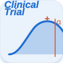
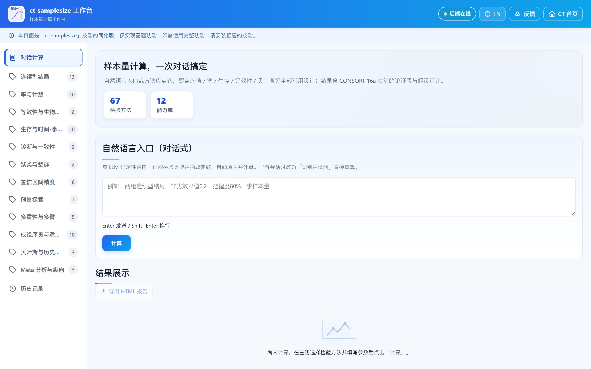

# 临床试验样本量专家（ct-samplesize）

- **English guide** → [README.md](https://github.com/medstatstar/ct-samplesize/blob/main/README.md) · **中文指南** → [README_zh-CN.md](https://github.com/medstatstar/ct-samplesize/blob/main/README_zh-CN.md)

  

> **不安装也能用：** 如果你不想安装，只想快速使用本技能的基础功能，也可直接访问ct系列技能的总入口网页 **https://ct.medstatstar.com** 使用。

  

> **面向临床试验从业者的易用型样本量与检验效能计算工具**
>
> 你不需要会编程，也不用手敲命令——只要在对话里用**日常语言描述你的试验设计**，就能完成 **65 种**专业的样本量与检验效能计算。默认权威引擎是**远程 coze R 计算服务**（rpact / TrialSize / PowerTOST 等 20+ 包在服务器端运行，本机**无需安装 R**；发布版**没有本地计算兜底**）。结果默认按操作系统语言设定给出中文或英文（可用提示词强制切换）。技能默认展示**安全预览**——即它将发往 coze 的精确请求信封，在你确认前不会真正发出；完整 R 代码可按需返回。

---

## 适用人群

`ct-*` 临床试验技能家族专用于解决临床试验全生命周期的各类需求，ct-samplesize 主要面向需要**可辩护的样本量 / 检验效能结果**（覆盖 **65 种**设计）的三类人群：

- **各制药企业的临床试验从业者** —— 申办方、CRO，以及医学 / 统计 / 注册等角色：为方案、SAP 或可行性评估快速算得可审计的 n / 效能。
- **在医疗机构中设计、管理临床试验项目，或参与临床试验研究实务的医护人员**：起草方案或可行性评估时估算样本量。
- **希望系统学习临床试验知识的医学专业学生**：探索组序贯、自适应、贝叶斯、非劣效等设计族。

---

## 一、如何在对话里使用（最核心）

ct-samplesize 是一个**对话式技能**：你直接用自然语言把试验设计告诉助手即可，无需记忆任何命令或参数名。技能作为 WorkBuddy 技能**自动加载，无需额外安装**。

下面 3 个示例演示三种最典型的进入方式：**说清设计直接算** → **不确定让助手追问** → **卡在选型给你菜单**。更多按检验族分组的完整案例（30 张）见第四节。

### 示例 1 · 说清设计，直接算（最常见的完整流程）
**你这样说：**
> 帮我算一下两组均数比较的样本量，效应量 d=0.5，把握度 80%，双侧 α=0.05

**助手会这样回（示意）：**
> 已为你生成两独立样本 t 检验（d=0.5，power=0.8，双侧 α=0.05）的**安全预览**——将发往 coze 的精确请求信封，未发送也未计算。你说「请直接计算」后返回：每组约 **64 例**（共 128 例），并自动附带「样本量随把握度」曲线（SVG 内联可编辑）；说「把完整 R 代码给我」可取回可复现脚本。

**📌 流程就三步**：描述设计 → 检视安全预览 → 说「请直接计算」。默认不发任何内容；「把完整 R 代码给我」贯穿所有检验。
**🖥️ 工作台：** 打开 **https://ct.medstatstar.com** → 选 **ct-samplesize** → 首页的 **自然语言入口（对话式）** 输入框 → 写同一句话 → 点 **计算**。结果卡给出每组 n / 总样本量、把握度-n 曲线，并带 **导出 HTML 报告** 按钮。想走表单也行：左侧选检验族（如 *连续型结局* → 两组均数），填参数后点 **计算**，出的是同一组数字。

### 示例 2 · 不确定该用什么检验（最常见的开场白）
**你这样说：**
> 我想做个样本量计算，但不知道该用哪种检验，你帮我参谋一下

**助手会这样回（示意）：**
> 没问题，我们先把试验设计理清楚。我每轮问 1–3 个聚焦问题，每个都带推荐默认答案——你确认或调整即可。
>
> **第 1 轮（2 题）：**
> 1. 你的**主要终点**是什么类型？—— 连续型（如血压差值）/ 二分类（如有效率）/ 生存时间（如 OS）/ 其他？
> 2. 是**平行组**还是**交叉 / 配对**设计？（多数设计是平行组——没有特别说明就按这个来）
>
> *（你回答……）*
>
> **第 2 轮（2 题）：**
> 3. 你想证明的是**优效**、**非劣效**还是**等效**？
> 4. 若终点是「二分类 / 率」，**效应量表达**是关键分叉：要**绝对率差**（对照 60% vs 试验 75%，差 15pp → `proportion_two`）还是以 **OR / RR** 为主效应（OR=2.0 → `odds_ratio`、RR=1.5 → `risk_ratio`）？两者样本量公式差别很大，OR 通常更费样本。
>
> *（锁定检验类型与效应量表达后，我会回显「需求画像 + 推荐检验 + 待补参数」摘要请你确认，再进入计算——期间不会把 65 种检验的菜单甩给你。）*

**📌 说明**：当你说"不确定用什么检验"时，助手会用**逐分支追问**帮你理清需求，而不是把 65 种检验菜单砸过来。说清楚了自然就进入计算。
**🖥️ 工作台：** 工作台没有 grill-me 对话，改用左侧导航当决策助手：它把 67 种检验分成 12 个族（连续型结局 / 率与计数 / 等效性 / 生存与时间-事件 / 诊断与一致性 / 聚类与整群 / 置信区间精度 / 剂量探索 / 多重性与多臂 / 成组序贯与自适应 / 贝叶斯与历史对照 / Meta 分析与纵向），每个族下列出检验及其所需参数。选最接近的族、点开一个检验，表单会直接告诉你还缺哪些输入。

### 示例 3 · 多检验选型 / 设计族抉择（弹出菜单）
**你这样说：**
> 比较两种降压药对诊室收缩压的影响，平行组设计，把握度 90%。但我没想好是做优效还是非劣效，也不知道要不要加期中分析。

**助手会这样回（示意）：**
> 终点（连续型·诊室收缩压）和设计（平行组）已经清楚了。剩下两个关键选择，我列个菜单帮你定：
>
> **① 想要证明什么？**
> - (a) 优效：新药比对照降得更低 → `ttest_ind`（优效）
> - (b) 非劣效：不差于对照，margin 由你定 → `non_inferiority`
>
> **② 是否加期中分析？**
> - (a) 不加，固定样本量 → 普通 t 检验
> - (b) 加 1–2 次期中、可早停 → `group_sequential` 族
>
> **③ 还拿不准？** → 说「详细解释这些选择之间的差异」，我先讲清临床与统计含义再让你决定。
>
> 你勾一下 ①② 的偏好，或直接选 ③ 听讲解，我就锁定检验并进入参数补全 / 计算。

**🖥️ 工作台：** 工作台里这两个分叉变成了左侧的两个入口而不是菜单：**等效性与生物等效** 覆盖优效 / 非劣效 / 等效 margin，**成组序贯与自适应** 覆盖加不加期中分析。两边都点开、把参数字段并排比一比，再算你定下来的那个 —— 两个结果都能留在历史面板里对照。

**📌 说明**：当你**已点名检验类型、却卡在「选型 / 设计族」上**（比如优效 vs 非劣、加不加期中），助手会**弹出路由菜单**帮你逐步确认，而不是替你拍板或直接甩 65 种全菜单。菜单里也提供「详细解释差异」选项——拿不准时先讲清楚再决策。完整分类树可在对话里说「**列出全部 65 种检验**」展开查看。

---

> 💡 **小提示**：多数检验只需「效应量（或率 / HR）+ 把握度 + α」三个要素；没说全的部分（如双侧 α=0.05、1:1 随机、随访时间）会用常规默认补全，说不全助手也会提示缺哪些。**更多按检验族分组的完整案例（30 张）→ 第四节。**

## 二、你能算什么 — 65 种检验场景索引

按**终点 / 方法类型**分 7 大类。下表给出每类典型的「临床场景」和一句你可以**直接照抄**的「试试这样说」。同一检验也可从「设计族」交叉进入（组序贯、自适应、等效 / 非劣、贝叶斯、剂量递增、MAMS、历史对照、疫苗、胜率统计等）——对话里说「**列出全部 65 种检验**」即可展开完整能力菜单。

> 底层 R 引擎运行在 **coze 服务器端**（rpact / TrialSize / PowerTOST 等）；发布版技能本机不携带任何 R。架构说明见第五节「进阶参考」，普通使用者无需关心。

### ① 连续型终点
| 类型 | 临床场景 | 试试在对话里这样说 |
|:---|:---|:---|
| `ttest_ind` | 两均数比较（平行） | "两组均数比较，d=0.5，power 0.8" |
| `ttest_paired` | 配对 t / 2×2 交叉 | "配对设计样本量，效应量 0.5" |
| `ttest_one` | 单样本 vs 已知均值 | "单样本检验，和已知均值差 0.5" |
| `anova` | 多组比较（k 组） | "3 组 ANOVA，效应量 f=0.25" |
| `equivalence` | 等效性（均数） | "均数等效性，margin=2，效应量 1" |
| `mixed_model` | 重复测量 / 纵向（给定 n 求效能） | "重复测量设计效能，n=100，效应量 0.5" |

### ② 二分类终点
| 类型 | 临床场景 | 试试在对话里这样说 |
|:---|:---|:---|
| `proportion_two` | 两组率（卡方） | "对照组 20% 试验组 35%，两组率比较" |
| `proportion_one` | 单组率 | "单组率检验，预期 30%" |
| `proportion_paired` | 配对率（McNemar） | "配对率比较 McNemar，p1=0.7 p2=0.5" |
| `odds_ratio` | 比值比 | "OR=2 的样本量，对照率 50%" |
| `risk_ratio` | 风险比 | "RR=1.5 的样本量，对照率 50%" |
| `non_inferiority` | 非劣（率） | "非劣效，margin=0.1，对照 85% 试验 80%" |
| `superiority_margin` | 优效（界值） | "优效性检验，界值 0.05" |
| `be_tost` | 生物等效（TOST） | "BE 样本量，theta0=0.95，CV=25%" |
| `vaccine_efficacy` | 疫苗效力 | "疫苗效力，对照 VE=0.02 试验 0.005" |
| `gsd_proportion` | 组序贯两比例 | "组序贯两比例，1 次期中，p1=0.7 p2=0.5" |

### ③ 计数·率终点
| 类型 | 临床场景 | 试试在对话里这样说 |
|:---|:---|:---|
| `poisson` | Poisson 率 | "两组发生率比较，λ1=0.05 λ2=0.03" |
| `recurrent_events` | 复发事件（Andersen-Gill） | "复发事件样本量，对照率 1.0" |
| `gsd_poisson` | 组序贯 Poisson 率 | "组序贯 Poisson 率" |

### ④ 生存·时间-事件终点
| 类型 | 临床场景 | 试试在对话里这样说 |
|:---|:---|:---|
| `survival` | 生存（简化 logrank） | "生存分析，HR=0.75，power 0.85" |
| `survival_exact` | 生存（精确） | "精确生存样本量，HR=0.75，入组 12 月" |
| `ni_survival` | 非劣生存 | "非劣生存，HR margin=1.25" |
| `survival_equivalence` | 生存等效（TOST / log-HR） | "生存等效，margin=1.25" |
| `survival_superiority` | 生存优效 + 界值 | "生存优效，界值 0.8" |
| `cox_covariate` | Cox 回归（含协变量 R²） | "Cox 回归样本量，HR=2，R²=0.3" |
| `survival_one_sample` | 单组指数生存 | "单组生存，中位 12 vs 18" |
| `competing_risks` | 竞争风险（累积发生率） | "竞争风险样本量，CIF 0.2 vs 0.1" |
| `survival_historical` | 历史对照 logrank | "历史对照生存，历史中位 12 新 18" |
| `gsd_survival` | 组序贯 logrank | "组序贯生存，1 次期中，HR=0.7" |
| `gsd_hazard` | 组序贯风险比（HR） | "组序贯 HR，HR=0.7" |
| `gsd_survival_sim` | 组序贯 logrank — 蒙特卡洛模拟 | "组序贯生存模拟，2 次期中" |
| `gsd_hazard_sim` | 组序贯 HR — 蒙特卡洛模拟 | "组序贯 HR 模拟" |

### ⑤ 诊断·方法比较
| 类型 | 临床场景 | 试试在对话里这样说 |
|:---|:---|:---|
| `roc` | ROC 曲线 / 诊断试验 | "ROC 曲线样本量，AUC 0.5→0.75" |
| `bland_altman` | Bland-Altman 方法学比对 | "Bland-Altman 样本量，SDdiff=5，界值 2.5" |

### ⑥ 特殊·高级设计
| 类型 | 临床场景 | 试试在对话里这样说 |
|:---|:---|:---|
| `group_sequential` | 组序贯 / 期中分析 | "组序贯设计，2 次期中，Pocock" |
| `adaptive` | 适应性设计 | "适应性设计，2 阶段" |
| `adaptive_simulate` | 适应性设计 — 蒙特卡洛模拟 | "适应性设计蒙特卡洛模拟" |
| `bayesian` | 贝叶斯设计 | "贝叶斯设计，对照 0.3 试验 0.15" |
| `dose_escalation` | 剂量递增（I 期） | "I 期剂量递增，5 个剂量，DLT 0.33" |
| `mams` | 多臂多阶段（MAMS） | "MAMS，3 臂 2 阶段" |
| `dunnett` | Dunnett 多重比较 | "Dunnett，3 组对照 50" |
| `win_ratio` | Win-Ratio 复合终点 | "Win-Ratio 样本量，WR=1.5" |
| `must_win` | Must-Win / 共主要终点 | "共主要终点 3 个，相关 0.5" |
| `historical_controls` | 历史对照借用 | "历史对照借用，历史应答 15/100" |
| `conditional_power` | 条件效能 / 样本量重估计 | "条件效能，中期效应 0.2" |
| `assurance` | 贝叶斯确信度 | "确信度计算" |
| `multiple_endpoints` | 多重 / 复合终点 | "多终点样本量，相关 0.5" |
| `mediation` | 中介效应样本量 | "中介效应样本量" |
| `cluster` | 整群随机设计 | "整群随机，ICC=0.05，每群 30" |

### ⑦ 相关 / 方差 / CI 精度 / 回归 / Meta 规划（v5.9–v5.10 新增）
| 类型 | 临床场景 | 试试在对话里这样说 |
|:---|:---|:---|
| `correlation` | 相关检验（H0:ρ=0，Fisher-z 精确） | "相关分析样本量，预期 r=0.3，power 0.8" |
| `variance_one` | 单样本方差（χ²） | "单样本方差检验，标准差是参考值的 1.5 倍" |
| `variance_two` | 两方差之比（F 检验） | "两方差比较，比值 2，power 0.8" |
| `cv_one` | 变异系数估计的相对误差精度 | "CV 估计，CV=0.2，相对误差 10%" |
| `ci_mean` | 均值置信区间精度（半宽→n） | "均值 95% 置信下控制在 ±2 内，SD 10，要多少例？" |
| `ci_prop` | 比例置信区间精度 | "比例 CI 半宽 0.1，预期 50%" |
| `ci_or` | 优势比置信区间精度 | "OR 的 CI 半宽 0.5，基线率 30%，OR=2" |
| `ci_rr` | 风险比置信区间精度 | "RR 的 CI 半宽 0.3，基线率 30%，RR=1.5" |
| `ci_cor` | 相关系数置信区间精度 | "相关系数 CI 半宽 0.1，预期 r=0.5" |
| `ci_icc` | 组内相关系数置信区间精度（信度） | "ICC 的 CI 半宽 0.15，ICC=0.3，2 名评价者" |
| `regression_linear` | 多重线性回归 R² 检验（Cohen's f²） | "线性回归 R² 检验，3 个预测变量，f²=0.15" |
| `regression_logistic` | 逻辑回归（Hsieh 1998/1989） | "逻辑回归，OR=1.5，基线率 50%，power 95%" |
| `regression_poisson` | 泊松回归（Signorini 1991） | "泊松回归，基线率 1，RR=1.3，φ=1" |
| `cluster_ext` | 整群随机化广义设计效应（不等群） | "整群试验，ICC 0.05，每群 20，群大小 CV 0.5" |
| `rates_ext` | 率扩展（过离散 / CI 精度） | "过离散率比，λ1=0.5 λ2=0.25，φ=2" |
| `meta_planning` | Meta 分析前瞻规划 | "Meta 规划，SMD 0.3，每研究 100 例，I²=0.3，power 0.8" |

---

## 三、首次使用常见问题（FAQ）

**Q：我只说了效应量和把握度，没给别的参数，能算吗？**
A：能。多数检验只需「效应量（或率 / HR）+ 把握度 + α」三要素。没说全的部分（如双侧 α=0.05、1:1 随机、随访时间）会用常规默认补全；若某项确实必需而缺失，助手会提示你补充。

**Q：结果里的 n 是每组还是总人数？**
A：默认报 **每组 n（per group）**；配对 / 交叉设计报序列数，生存类常报所需总事件数。输出里都会标注清楚，不用担心误解。

**Q：我想要可复现的 R 代码用于递交或核查，怎么要？**
A：说 **「把完整 R 代码给我」** 即可。代码默认也会以安全预览展示，可复制、修改后自行重跑。

**Q：中文环境下面输出是中文吗？**
A：是。默认跟随操作系统的语言设定给出中文或英文结果；你也可以用提示词（如"用中文回复"或"switch to English"）随时强制切换。

**Q：如果数据要保密怎么办？**
A：可以使用相同的设计框架，但是对原始数据均进行替换（如用模拟的占位数据跑通流程），要求技能输出完整 R 代码，然后自行在本地使用真实数据运行这段代码即可——技能本身只发送设计参数，从不接触你的原始数据。

**Q: 发现结果有误怎么办？怎么上报？**
A: 本技能遵循内置的错误报告流程。若您怀疑结果有误（或引擎报错），直接说 **"上报问题" / "report a bug" / "提交错误报告"**。技能在检测到疑似缺陷时（如引擎报错、重试仍失败）也会**主动询问**是否上报——**每会话最多 1 次**，您可随时拒绝。无论哪种方式，助手都会：
1. **生成一份脱敏报告**（11 键白名单：skill / skill_version / test / error_type / error_code / engine_status / description / locale / query_origin / session_hash / attempts——**不含您的原始输入值或个人数据**，仅 `description` 字段由您把关披露，如所用算法/函数、错误消息原文）；
2. **展示报告全文供您检视**——可补充问题描述或更正任何内容后再确认；
3. **经您明确确认后发送**——本会话有 coze 调用则发往统一端点 `https://ct-bugreport.coze.site/run`；纯本地则保存脱敏报告 + 提示邮件联系作者（数据不出域）；
4. **收到回执**——包括您此前从同一来源提交的报告是否已被修复（含修复说明）或仍在处理中。

整个过程您完全可控：报告在**发送前**先展示给您，未经您明确说「发送」绝不传输任何内容。

---

**Q：能接着上一轮的计算改参数吗？**
A：能。上一轮会回显一张「当前分析设定」块，之后你只说改什么（如"把握度提到 90%，改单侧"），未提及的字段原样继承、改动字段明确覆盖，不会被悄悄修改；也可以说"用更保守的 SD 重做一遍"做敏感性假设重算。每轮改动都会明确列出。

## 四、使用案例大全（上下文提示词方式 · 简单 / 中等 / 复杂）

> 每张卡片都是一段可直接照抄的对话提示词；默认展示安全预览，说「请直接计算」才真正运行。生存类设计请一并给出**事件率与入组 / 随访时间表**——它们直接决定样本量（见 S2）。

每张卡片都标注了**难度级别**，对应助手对请求的判级逻辑（详见 `SKILL.md`）：

| 级别 | 含义 | 助手行为 |
|:---|:---|:---|
| **简单** | 你已点名检验、且基本给全了参数 | 直接作答，**不弹菜单**；回显 `## 当前分析设定：` 块供后续追问继承 |
| **中等** | 单一深入点（ICH 细则、某个统计参数、合规灰色地带） | 同样直接作答、不弹菜单，但回答更丰厚多点 |
| **复杂** | 你清楚设计、却在检验类型 / 设计族之间犹豫 | 弹出**两级路由菜单** + 「详细解释差异」选项 |
| **模糊** | "我不确定该用什么检验" | **有界的逐分支追问（grill-me，≤3 轮）**，绝不会把 65 种检验菜单甩给你 |

> 默认情况下技能展示**安全预览**（即将发往 coze 的精确请求信封），不发任何内容。说 **「请直接计算」** 才会真正运行。说 **「把完整 R 代码给我」** 可取回可复现脚本。这两个触发词贯穿全文。

**🖥️ 这一整节的工作台用法：** 下面每张卡片在工作台上都是同两步 —— ① 在左侧选对应族（卡片分组与工作台家族一一对应：4.1 连续型 → *连续型结局*，4.2 二分类 → *率与计数*，4.4 生存 → *生存与时间-事件*，依此类推）② 按表单要求填参数、点 **计算**。结果都留在 **历史** 面板里，可以重新打开上一次结果、改一个假设再算一遍 —— 「中等」「复杂」档的卡片大多是这么用的。

---

### 4.1 连续型终点（均数）

#### A1 · 简单 — 两均数比较，参数齐
**你这样说：**
> 帮我算一下两组独立均数比较的样本量，Cohen's d = 0.5，把握度 80%，双侧 α = 0.05

**助手会这样回（示意）：**
> `ttest_ind`（双侧）。每组约需 **64 例**（共 128 例）；按 10% 脱落调整，每组计划 **71 例**。完整 R 代码可随时索要。
> `## 当前分析设定： test=ttest_ind | effect(d)=0.5 | alpha=0.05 | power=0.8 | solve=n | side=two | sd=— | n=64 | ratio=1.0`

#### A2 · 中等 — 把临床语言里的 Δ 折算成 d
**你这样说：**
> 我预期新药能把空腹血糖比安慰剂多降 12 mg/dL。SD 大约 30 mg/dL。每组需要多少例才能有 90% 把握度？

**助手会这样回（示意）：**
> 这是两样本 t 检验。Δ = 12，SD = 30 → **Cohen's d = 0.40**。在 90% 把握度、双侧 α = 0.05 下：每组约 **134 例**（共 268 例）。注：默认按 1:1 分配；若分配比不同请告诉我，我重新算。

### 4.2 二分类 / 率

#### B1 · 简单 — 两组率，卡方
**你这样说：**
> 对照组有效率 20%，试验组 35%，做两组率比较的卡方检验，α=0.05 双侧，power=0.8

**助手会这样回（示意）：**
> `proportion_two`：每组约需 **137 例**（共 274 例）。已自动附带样本量曲线。

#### B3 · 复杂 — 非劣 margin、BE 还是优效？
**你这样说：**
> 这是个 2×2 交叉的生物等效（BE）研究。参考药 CV 约 25%，我们预期 theta0 = 0.95。但我统计师也提到了非劣效——我该按哪个框架定样本量？

**助手会这样回（示意）：**
> **① 哪种框架？**
> - (a) 通用 BE（TOST） → `be_tost`（theta0=0.95，CV=25%，2×2）——通常 n 最小
> - (b) 率的 / 比例的 非劣效 → `non_inferiority`（需给 margin）
> - (c) 生存非劣效 → `ni_survival`（HR margin）
> **② 还拿不准？** → 「详细解释这些选择之间的差异」。对 2×2 交叉 PK 研究，BE 才是正解；你确认后我就按 `be_tost` 定样本量。

---

### 4.3 计数 / Poisson

#### C1 · 简单 — 两组 Poisson 率
**你这样说：**
> 两组 Poisson 率比较，λ1 = 0.05，λ2 = 0.03，每人暴露 2 年，80% 把握度

**助手会这样回（示意）：**
> `poisson`：每人 2 年暴露下，**每组约 1,041 例**（共 2,082 例）。暴露时间缩短会抬高所需 n——告诉我每人的随访时长我帮你调整。

### 4.4 生存 / 时间-事件

#### D1 · 简单 — log-rank，HR 给定
**你这样说：**
> 生存试验，HR = 0.75，事件率 30%，入组 12 个月、随访 12 个月，1:1 随机，把握度 85%，双侧

**助手会这样回（示意）：**
> `survival`：需要 **434 个事件**（Schoenfeld）；该时间表下期望事件比例 0.2337 → 每组 **929 例**（共 1858 例）。结果会打印期望事件比例供你核对；时间表改动会直接改变样本量（见 S2）。

#### D2 · 中等 — 非劣生存，含入组/随访
**你这样说：**
> 非劣生存设计，HR margin 1.25，预期 HR 1.0，事件率 60%，入组 12 个月、随访 12 个月，把握度 80%。

**助手会这样回（示意）：**
> `ni_survival`：该时间表下期望事件比例 0.3402 → **每组约 730 例**（共 1460 例）。若事件率提高到 70%，期望事件比例升到 0.4132，每组降到约 **601 例**——事件率假设对生存设计样本量的杠杆很大。未假设因无效早停；想加期中可上组序贯框架。

### 4.5 诊断 / 方法比较

#### E1 · 简单 — ROC / AUC 试验
**你这样说：**
> 诊断研究，我想检出 AUC 从 0.5 提升到 0.75，80% 把握度

**助手会这样回（示意）：**
> `roc`（Obuchowski）：在病例-对照 1:1 下，区分 AUC 0.50 与 0.75、80% 把握度需 **约 110 名受试者**。

### 4.6 组序贯与期中分析

#### F1 · 简单 — 一次期中，点名检验
**你这样说：**
> 组序贯生存设计，1 次期中，HR = 0.7，12 月入组、12 月随访，80% 把握度，O'Brien-Fleming

**助手会这样回（示意）：**
> `gsd_survival`：**每臂约 178 例**（约 198 个事件），采用 1 次 O'Brien-Fleming 期中。期中可因有效/无效早停，且不放大一类错误。

#### F2 · 中等 — 消费函数 + 无效停止
**你这样说：**
> 我想在连续终点上做 2 次期中（效应量 0.4），Pocock 消费函数，并且还要加无效停止。90% 把握度。

**助手会这样回（示意）：**
> 成组序贯设计，Pocock 边界 + 无效停止：2 次期中、效应量 0.4、90% 把握度 → **每臂约 95 例**。Pocock 在各次查看间给相等边界；加无效停止可在治疗明显失败时早停（省样本），代价是轻微效率损失。

### 4.7 自适应 / 贝叶斯 / 确信度

#### G1 · 简单 — 自适应设计，2 阶段
**你这样说：**
> 适应性设计，2 阶段，效应量 0.4，80% 把握度

**助手会这样回（示意）：**
> `adaptive`：2 阶段、效应量 0.4 → **每臂约 100 例**（分阶段），并给出预设的适应规则（如期中因无效停）。助手会列出阶段边界。

#### G3 · 复杂 — 确信度 vs 频率学把握度
**你这样说：**
> 我团队总把"把握度"和"确信度"混为一谈。能不能在 n=100 上算确信度，并解释它和我已经定好的 80% 把握度有何不同？

**助手会这样回（示意）：**
> `assurance` 在 n = 100（如 5,000 次模拟）回报**试验成功的概率**——对参数不确定性取平均，通常*低于* 80% 的条件把握度（后者假设你给的效应估计完全准确）。我会同时给出两个数字，并解释：确信度计入了你假设效应的不确定性，而把握度是在该假设下条件成立的。

---

### 4.8 剂量递增、MAMS、多重性

#### H1 · 简单 — I 期剂量递增
**你这样说：**
> I 期剂量递增，5 个剂量水平，目标 DLT 率 0.33，3+3 风格

**助手会这样回（示意）：**
> `dose_escalation`：5 个剂量、目标 DLT 0.33 → 设计给出各剂量的推荐样本与 MTD 寻找规则（如 3+3 或 CRM）。助手回报的是**每剂量的推荐样本与停止规则**，而非单一"n"。

#### H3 · 复杂 — Dunnett vs MAMS 多重比较
**你这样说：**
> 我有一个对照和 3 个治疗臂，没有自适应元素。该用 Dunnett 还是 MAMS 定样本量？

**助手会这样回（示意）：**
> **① 固定还是适应？**
> - (a) 固定多臂、无期中 → `dunnett`（控制 3 vs 对照的族误率）
> - (b) 你想在期中淘汰臂 → `mams`
> **② 还拿不准？** → 「详细解释这些选择之间的差异」。既然你说没有自适应元素，`dunnett` 是更简单且正确的选择。

---

### 4.9 胜率统计、历史对照、整群、多重终点

#### I1 · 简单 — Win-Ratio 复合终点
**你这样说：**
> Win-Ratio 样本量，WR = 1.5，1,000 次模拟

**助手会这样回（示意）：**
> `win_ratio`：目标 Win-Ratio 1.5 下，**每臂约 350 例**（1,000 次模拟近似）。Win-Ratio 把复合时间-事件结局（死亡 + 再住院）纳入单一层级处理。

### 4.10 双向求解 — 给定 n，求把握度？

#### J1 · 简单 — 反向求解
**你这样说：**
> 我们已经按 t 检验纳入每组 50 例（d=0.5）。实际把握度是多少？

**助手会这样回（示意）：**
> 反向求解（把 n 固定为 50/组）：n = 50/组、d = 0.5 下你实际有 **约 70% 把握度**（而非你当初定的 80%）。考虑加 n 或接受较低把握度——说一声我给你画把握度曲线。

### 4.11 曲线模式与默认图形

#### K1 · 简单 — 固定 n 序列的把握度曲线
**你这样说：**
> 给两样本 t 检验（d=0.5）画一条把握度随 n（20 到 200）变化的曲线。

**助手会这样回（示意）：**
> 把握度曲线（x = n，y = 把握度）自动绘制：n = 64/组时跨过 80%；曲线还画出目标把握度参考线。SVG 内联、可编辑。

### 4.12 涉密输入与数据不出域

#### M2 · 中等 — 数据不出域（涉密输入）
**你这样说：**
> 我的设计涉密——不想让参数离机。还能拿到 R 代码自己跑吗？

**助手会这样回（示意）：**
> 可以。我们只跑*框架*——把任何真实数字换成占位，我输出**完整 R 代码**，你再用真实涉密值在本地执行。只有设计参数才会发往 coze，原始文档/数据从不外发。（要完全离线，可设 `CTSS_COZE_MOCK=1` 演示，或用可选的本地 R 开发后端。）

### 4.13 来自公开文献的效应量参考

#### N1 · 中等 — 检索公开荟萃分析作基准
**你这样说：**
> 帮我从公开文献里找肝细胞癌总生存期（OS）的荟萃分析效应量，用作我的设计假设基准。

**助手会这样回（示意）：**
> 助手检索公开文献 → 产出**候选确认表**（尺度 / 点估计 / 95%CI / 原文摘录句 / PMID）。你逐条对照摘要核实（摘要没有的数值拉全文补录），确认无误的条目对助手说「**入库**」才进入效应量参考库。候选**绝不自动入库**。

#### N2 · 复杂 — 采纳基准，取保守界
**你这样说：**
> 用刚入库的 HCC OS 参考，但先只给我看参考清单——别代入。然后按最保守（对样本量最不利）的 CI 界在 80% 把握度下代入计算。

**助手会这样回（示意）：**
> 第一步（展示模式）：打印参考清单及来源——**绝不静默代入**。第二步（显式采纳）：对助手说「**采纳保守界**」，即把最不利的 CI 端点代入 `ttest_ind`（若尺度不兼容则硬拒绝，如把 HR 参考喂给 t 检验）。采纳来源与 `basis` 会打印并写入假设清单供审计。

#### N3 · 复杂 — 护栏：技能拒绝做什么
**你这样说：**
> 我的基准文件里同时有一条 Cohen's d 和一条 HR——直接取中位数吧。对了，有条 meta 的 CI 跨过了 1，也帮我代入。

**助手会这样回（示意）：**
> 两个请求都会被**按设计拒绝**：
> 1. **混 param/scale**——混用 (param, scale) 的文件（d + HR，甚至 d + MD：同 param 但尺度不同，标准化 vs 原始）一律拒绝 median / conservative / low / high 聚合：跨尺度平均没有意义。请拆分文件，或**按序号单选**某一条来源。
> 2. **CI 跨越零假设**——CI 跨越零假设（effect 跨 0、比值跨 1）的参考仅展示、不可采纳：聚合选择先剔除再统计（`basis` 标注剔除数），显式**按序号**点到跨零参考则**硬拒绝**——真实效应可能为 0 或反向。
> 尺度冲突同样硬拒绝（HR 参考喂给 t 检验、OR 参考喂给 t 检验）——见下方红线。混尺度文件仍可正常**展示**（按 param 分组、跨零来源打标），受闸的只是**采纳**。

**两种操作方式（都绝不静默代入）**
1. **展示模式**：说「先给我看参考清单——别代入」→ 打印参考条目与来源，仅展示；
2. **显式采纳**：说「采纳保守界」→ 把选定的 CI 端点代入计算，来源与依据（basis）同时打印并写入假设清单，可复现 R 代码的注释会标注同一来源。敏感场景可做**三点敏感性**（CI 下界 / 中位 / 上界各算一次），或**按序号**指定单一来源。
   （命令行入口与完整参数见文末「进阶参考」。）

**可采纳的参考类型**：效应量（d / MD / SMD，服务 t 检验、ANOVA、Meta 规划）、HR（服务生存检验）、OR（服务 OR 精度、logistic 回归）、RR（服务 RR 精度、Poisson 回归、过离散率）。比值型估计与 CI 须严格为正；**CI 跨越零假设（效应量跨 0、比值跨 1）的参考仅展示、不可采纳**（真实效应可能为 0 或反向）；混尺度文件禁止中位数 / 保守界等聚合选择（跨尺度平均无意义），请**按序号单选**。

**红线**：参考 ≠ 代入——人群/终点/效应量尺度可比性由你复核；尺度冲突（如 HR 参考喂给 t 检验、OR 参考喂给 t 检验）会被硬拒绝。

---

### 4.14 文档上传 → 参数提取

#### O1 · 中等 — 上传方案 / SAP
**你这样说：**
> *（上传 `protocol.docx`）* 这是我们草稿方案——把样本量假设抽出来算一下。

**助手会这样回（示意）：**
> 文档解析在**本地**完成（docx / pptx / xlsx 转 Markdown，零依赖；pdf 为二进制格式无法零依赖解析，会指引调用环境里的 pdf 技能，扫描件需 OCR）。助手从转换后的 Markdown 里**只抽取设计参数**（检验、效应、α、power、n…）——原始文档文本**绝不发往 coze**。随后回显解析出的 `## 当前分析设定：` 块请你确认后再计算。（若方案涉密，按 4.12 M2 完全本地计算。）

---

### 4.15 新检验族 — 相关 / 方差 / CI 精度 / 回归 / Meta 规划

v5.9–v5.10 共新增 16 种检验（49 → 61 → 65），补齐 PASS 覆盖缺口。下面几张卡片是 4.1–4.9 尚未覆盖的检验族的对话入口。

#### Q1 · 简单 — 相关检验
**你这样说：**
> 我预期生物标志物与疗效的相关系数 r = 0.3。80% 把握度需要多少受试者？

**助手会这样回（示意）：**
> `correlation`（Fisher-z 精确，H0: ρ=0）：80% 把握度、双侧 α=0.05 下 **共约 85 例**。改单侧或预期相关更高都会降 n——说一声我就重算。

#### Q2 · 复杂 — Meta 分析前瞻规划 + 异质性扫描
**你这样说：**
> 我们在筹划一项 Meta 分析：预期 SMD 0.3，每研究约 100 例，异质性 I² 约 30%。80% 把握度需要几项研究？如果异质性比预期高呢？

**助手会这样回（示意）：**
> `meta_planning`（Hedges & Pigott 2001 随机效应）：I² = 0.30 时需要 **K = 3 项研究**。默认输出还带**异质性扫描**——I² ∈ {0, 0.25, 0.5, 0.75, 0.9} 各水平所需 K（本例约 2 / 3 / 4 / 8 / 18）及 K–I² 曲线，规划对异质性的敏感性一目了然。也可以直接给 R 而不给 I²（R = I²/(1−I²)，R=0 即固定效应），或者反过来问「给定 K，把握度多少」；要以非零 H0 效应（如既往 Meta 汇总值）为对照，说一声就会进入 λ 分子。整群设计的研究可以声明簇大小变异，它会放大设计效应。

#### Q3 · 中等 — 不等群大小与过离散率
**你这样说：**
> 整群随机试验，ICC 0.05，每群 20 人——但各群大小差异很大（CV 约 0.5）。另外我们的计数终点有过离散（φ≈2），率 0.5 对 0.25。

**助手会这样回（示意）：**
> 两个扩展正好覆盖这类褶皱：`cluster_ext`（广义设计效应 DE = 1+[(1+CV²)·m−1]·ρ）——CV = 0.5、m = 20、ICC = 0.05 时设计效应 **约 2.20**（等群时仅 1.95），每组 100 个个体膨胀到 **221**，即 **每臂 12 群（共 24 群）**。计数终点用 `rates_ext --rate_mode ratio`、φ = 2：λ 0.5 vs 0.25、80% 把握度下 **每组约 197 例**（共 394 例；φ = 1 时退化为普通 Poisson 检验）。`rates_ext` 还支持单率与率比的 CI 精度模式。

### 4.16 临床措辞假设与可审计输出

#### R1 · 中等 — 可直接贴进方案的论证段
**你这样说：**
> 给我一段能直接贴进方案的样本量论证。

**助手会这样回（示意）：**
> 单次计算成功后，CLI 会打印一行提议——**我会先问你一声再生成**。你确认后附带一段**中英双语、可直接用于 IRB/SAP 的论证段**（骨架：CONSORT-SPIRIT 第 14 条 / DELTA2 Box 4 + CDE《样本量估计指导原则(试行)》2024-12-23），写明实际所用软件及其版本（版本取自结果，不出现云端/本地字样）。占位处（如你的 MCID 来源）留空待你填写——拒绝假精确。

#### R2 · 复杂 — 计算前先审计假设
**你这样说：**
> 计算前先审计我的设计假设——效应量 0.5 来自一项 20 例的探索性研究——告诉我最薄弱的一环。

**助手会这样回（示意）：**
> 要一份**假设审计**，它会给每条假设分级 **known / weak / unknown / missing**（含造假特征启发式，你提供证据来源时会升级），把设计映射进 7 大设计逻辑族并做自洽校验，为最薄弱假设给出**回退 / 应急方案**——然后**停下而不计算**。小样本探索研究得来的 d = 0.5 通常判「weak」（小样本膨胀风险），回退方案为保守效应量。另外一道校验会用**独立的**蒙特卡洛引擎复算解析解（经验把握度 ±2pp / 一类错误 ±0.5pp），不达标时返回 `INCONCLUSIVE` 而非假 PASS——纯本地，不上网。

---

### 4.17 更多设计族实测 — 单样本 / 单组率 / 等效与优效 / 生存细节 / 模拟与再估计

> 以下案例覆盖 A–K、Q 系列之外的常用设计族，所有数值均为引擎实测输出（v5.13.26，默认双侧 α=0.05、把握度 80%、1:1 随机，未注明的均可用提示词修改）。每张卡片依旧遵循「你这样说 → 助手会这样回」。

#### S1 · 中等 — 生物等效性（BE）：2×2 交叉的 TOST
**你这样说：**
> 仿制药 BE 试验，几何均值比预期 0.95，个体内 CV 25%，2×2 交叉设计要多少例？

**助手会这样回（示意）：**
> `be_tost`（2×2，θ0=0.95，CV=25%）。总例数约 **28 例**。**教学点**：GMR 离 1 越远，样本量上升极快——同样的 CV，若 GMR 预期只有 0.90，总例数翻倍到 **56 例**。做 BE 时对 GMR 的把握比对 CV 的把握更值得反复核对。

#### S2 · 中等 — 时间表本身影响样本量（入组期 × 随访期）
**你这样说：**
> HR=0.7 的生存试验，事件率 30%。财务问入组期 12 个月还是 36 个月、随访 12 个月还是 18 个月各要多少人——三个方案一起算。

**助手会这样回（示意）：**
> `survival`（log-rank）。Schoenfeld 事件数恒为 **247**，但受试者数随时间表变：
> 1. 入组 12 月 + 随访 12 月 → 每组 **529**（期望事件比例 0.2337）
> 2. 入组 36 月 + 随访 12 月 → 每组 **626**（0.1974）——入组拉长，后入组者随访更短
> 3. 入组 12 月 + 随访 18 月 → 每组 **499**（0.2476）——随访拉长，事件更多
> 结果里会打印「期望事件比例」，n = 所需事件数 ÷ 该比例，可自行核对。**结论：先谈时间表，再谈样本量。**

#### S3 · 复杂 — 条件功率与样本量再估计（SSR）
**你这样说：**
> 试验做到一半，计划效应 0.3、实际观察到 0.2，已完成 100 例、原计划 200 例，时机 50%——还值得继续吗？要不要加样？

**助手会这样回（示意）：**
> `conditional_power`。当前趋势下条件功率仅 **77.8%**（低于 80% 目标）；按 H1 乐观再估需 **450 例**，SSR 增幅 **+125%**。三个数字放在一起看：继续按原计划做完的把握已不足，但把样本加到 450 例的代价是否可接受，是设计决策而非统计决策——我可以把两版的把握度曲线都画出来供决策会使用。

## 五、安全与声明

- **安全预览 / coze 计算是什么**：发布版技能**绝不在你本机运行 R 或 shell**。默认它调用远程 **coze** 计算服务（端点：`https://ct-samplesize.coze.site/run`），只发送试验设计参数（绝不发送患者数据）。想先看一眼，说 **「仅预览」**——会打印精确的请求信封、不发任何东西；说 **「请直接计算」** 即发送并取回数字与可选图形；说 **「展示代码」** 查看请求内容（含按需返回的 R 源码）。
- **离机会发送什么（元数据披露）**：每次 coze 请求携带 ① 你的试验设计参数（检验类型、效应量、α、power、n 等）；② `locale`（由操作系统语言推导，用于双语输出）；③ **主机名哈希** `query_origin`（你计算机主机名的 SHA-256 哈希——**不是**主机名本身，作者仅用于服务端归因/滥用限流）；④ **技能版本号** `skill_version`（读取本地 SKILL.md，用于按发布版本归因调用量与失败率）。不发送患者数据、文件内容或可识别个人信息。
- **错误报告（可选，仅在你确认时）**：若检测到疑似技能缺陷（如引擎错误且重试后仍在），助手可能询问是否发送一份**脱敏**错误报告到统一报告端点（`https://ct-bugreport.coze.site/run`）。报告含技能名/版本/错误类型，以及**经你审阅确认的问题描述**——可写明所用算法或函数、必要时含数值与研究设计（如 HR、power、分配比）；仅避免可识别的个人/机构/受试者身份信息。未经你确认不会发送任何内容；你可以随时拒绝；完全本地会话时改为生成本地报告文件并提供作者邮箱。
- **仅 coze**：发布版技能**没有本地计算兜底**——云端计算服务（`https://ct-samplesize.coze.site/run`）不可达时会提示配置 `CTSS_COZE_ENDPOINT`（或 `CTSS_COZE_MOCK=1` 本地演示），不会静默回退；全部 65 种检验均经 coze 服务端计算。
- **输出仅供参考**，用于监管申报前请独立验证。

---

## 六、进阶参考（已移至独立文件）

CLI 命令示例、双向求解、曲线模式、核心公式、系统要求、常见错误、文件结构、参考文献等开发者内容，已整理至 **[ADVANCED_zh-CN.md](docs/ADVANCED_zh-CN.md)**。普通使用者无需阅读；日常使用见第一至五节。

> **维护者必读**：工作台页面（`workbench/`）的**标准检验流程（发布前强制闸门）**——五层自动化测试（静态契约 / 后端 API / 前端单元 / 端到端 / 布局 a11y，共 110 例）已沉淀为随技能一起发布的工作台 QA 指南。任何工作台源码改动或发布前必须跑通。

---

## 版本信息

- **当前版本**：ct-samplesize v5.13.28（2026-10-22）
- **版本历史**：[CHANGELOG.md](CHANGELOG.md)
- **License**: MIT ｜ **Authors**: medstatstar, phoe-zip
- 如有功能改进建议、Bug 报告或其他反馈，欢迎直接联系作者：medstatstar@gmail.com（张文彤 / Wintone Zhang）

---

## 保密声明

> CT 全系列技能由 20+ 个技能构成，按「输入是否涉密」分为 **A、B 两档**，完整覆盖新药临床试验全流程。
>
> - **A 档（输入非涉密）**：输入为普通数据，不涉及保密信息，可本地安装后运行或Web网页方式使用，A 档技能均在 GitHub 公开发布。
> - **B 档（输入涉密）**：输入含药企需严格保密的临床试验数据 / 方案 / CRF 等；B 档既能安装后本地处理（可保证数据不出域），也能使用Web网页方式免安装使用（数据会脱敏后再上传），但B档技能本身均不对外公开发布。若有定制 / 本地部署需求，欢迎与作者联系。

